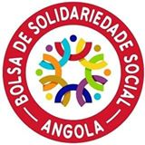
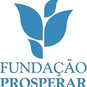
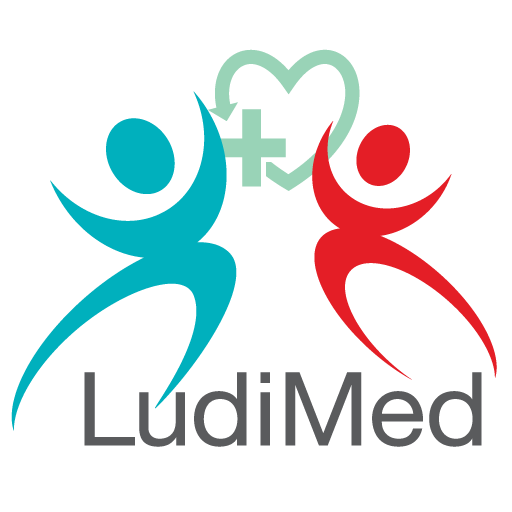

[Bolsa de Solidariedade Socia](https://www.facebook.com/Bolsa-de-Solidariedade-Social-Angola-487783584917240/)l, um presente para o futuro.

Juntos Somos Angola!

* * *

A [Caritas de Angola](https://www.caritasangola.org/) é uma federação de entidades de acção caritativa e social da Igreja Católica em Angola. É um organismo da Conferência Episcopal de Angola e São Tomé (CEAST) e membro da Caritas Internationalis. A Caritas de Angola procura ser uma força motora da caridade baseada na comunidade, promotora do desenvolvimento integral de cada homem. A Caritas de Angola desenvolve um trabalho de apoio e promoção social de grupos e comunidades em situação de precariedade e/ou exclusão social, procurando o seu bem-estar físico, material e espiritual, ajudando-os a ser construtores da sua própria história e do seu próprio desenvolvimento.

* * *

A [FUNDAÇÃO PROSPERAR](https://www.facebook.com/FundacaoProsperar/) é uma instituição de solidariedade social que tem por objecto a promoção do desenvolvimento social e humano dos angolanos.

* * *

A [LudiMed](https://ludimed.com/) é uma empresa sediada em Angola, especializada em importação e distribuição de medicamentos, consumíveis e dispositivos médicos.

Temos como linhas estrategicas, desenvolver, contribuir e fornecer soluções para um maior acesso a medicamentos, produtos hospitalares e areas relacionadas com a saúde.

E com tal, garantir o direito a uma vida melhor para todos os cidadãos.

* * *

* * *
