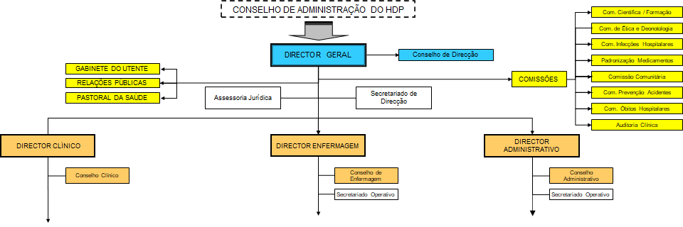
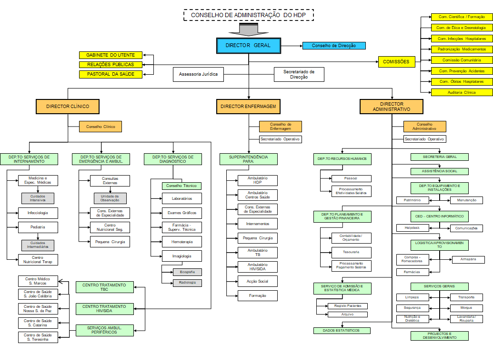

O Hospital Divina Providência (HDP), construído no ano 1994, é uma Instituição que pertence à Obra da Divina Providência, Organização não Governamental Nacional vinculada à Igreja Católica, sem fins lucrativos, cujo objecto social é oferecer assistência à população mais carente.

A ONG constituiu-se oficialmente em 28 em Janeiro de 2000, e obteve o reconhecimento do Governo Angolano mediante a publicação no Diário da Republica (III Série – N.º 32 do dia 11/08/2000) do estatuto e da acta constitutiva.
A nossa acção inspira-se no carisma de São João Calábria, padre italiano que viveu entre os séculos XVIII e XIX e que sentiu-se chamado a manifestar ao mundo a Paternidade de Deus e sua Providência no serviço a favor dos mais necessitados, com espírito de dedicação, disponibilidade e responsabilidade.

A Obra da Divina Providência (ODP) está presente em Angola desde 1982 e vem desenvolvendo importantes acções de impacto social, que abrangem o sector da saúde, a instrução, a formação profissional, a atenção às crianças órfãs e abandonadas.

No domínio da saúde, o HDP colabora activamente com o Sistema Nacional de Saúde Pública, sendo Orgão Dependente da Direcção Provincial de Saúde de Luanda.

A rede sanitária do HDP conta com um conjunto de 5 (cinco) unidades de saude perifericas e varios sectores diferenciados segundo o tipo de prestação de cuidados de saúde oferecidos. Assim temos unidades vocacionadas para a Atenção Primária (nível primário), uma unidade central de referência com prestações polivalentes (nível secundário), um centro para o tratamento de doenças infecciosas como Tuberculose e SIDA e um centro para o tratamento da malnutrição severa, de forma a dar uma resposta mais completa possível à demanda de assistência sanitária na Área da Saúde de nossa competência.

A estrutura central do Hospital compõe-se, na parte da frente, de um pavilhão de 2.000 m2 que acolhe o Departamento Administrativo, o Sector das Consultas Externas (Ambulatórios) e Especializadas, o Serviço de Admissão e Estatistica Medica e o Arquivo físico dos processos dos pacientes, e o Sector do Diagnóstico e Terapêutico, a Farmácia Interna e a Farmácia Externa, que disponibiliza os medicamentos para os doentes das Consultas Externas. Na parte de trás um pavilhão de 2.100 m2 que está destinado ao Sector de Internamento: Pediatria, Medicina, Doenças Infecciosas e Centro Nutricional Terapêutico.

O Município de Kilamba Kiaxi conta com uma população estimada em 700.000 habitantes, tendo registado nos anos passados maciços fluxos migratórios do interior devido à guerra. O Hospital foi classificado pelo Governo Provincial de Luanda como Hospital Municipal, tendo uma capacidade total de internamento de 147 camas.

Na Unidade Central existem quatro tipologias de internamentos: Pediatria (60 camas), Medicina Geral (40 camas), infecciologia (20 camas), Malnutrição Severa (27 camas), perfazendo um total de 147 camas disponíveis 24/24, 7/7. O atendimento nas Unidades Periféricas é apenas diurno.

Juntamente ao Hospital Municipal de Kilamba Kiaxi, o HDP conta com os serviços sanitários previstos no “Pacote Mínimo de Serviços” contemplado no DL n. 54/03, com particular cuidado aos serviços preventivos e curativos de Atenção Primária, dando assim cobertura à Área de Saúde de competência. Neste contexto, o Hospital faz parte da rede Sanitária do Serviço Nacional de Saúde em força de um acordo operativo assinado com a Direcção Provincial de Saúde de Luanda ao 03 de Fevereiro de 1997.

