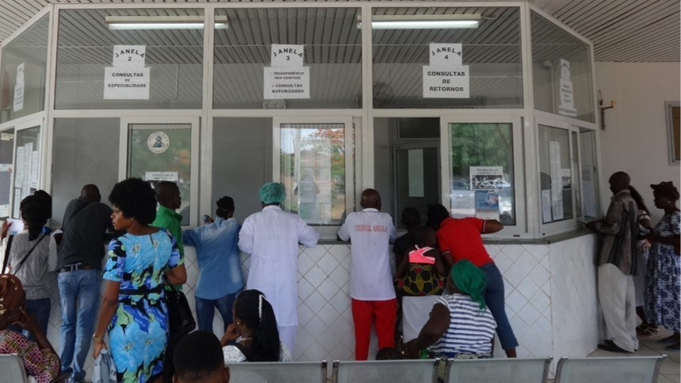
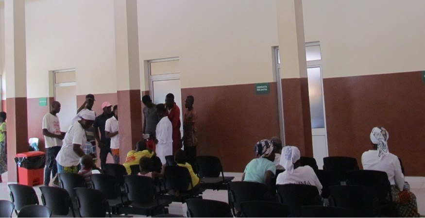

**Estrutura da Unidade Central**

A estrutura central do Hospital compõe-se, na parte da frente, de um pavilhão de 2.000 m2 que acolhe o Departamento Administrativo, o Sector das Consultas Externas (Ambulatórios) e Especializadas, o Serviço de Admissão e Arquivo Médico-estatístico, e o Sector do Diagnóstico e Terapêutico, a Farmácia Interna e a Farmácia Externa, que disponibiliza os medicamentos para os doentes das Consultas Externas. Na parte de trás um pavilhão de 2.100 m2 está destinado ao Sector de Internamento: Pediatria, Medicina, Doenças Infecciosas e Centro Nutricional Terapêutico.

O Município de Kilamba Kiaxi conta com uma população estimada de cerca 700.000 habitantes, tendo registado nos anos passados maciços fluxos migratórios do interior devido à guerra. O Hospital foi classificado pelo Governo Provincial de Luanda como Hospital Municipal, tendo uma capacidade total de internamento de aproximadamente 147 camas.

Juntamente ao Hospital Municipal de Kilamba Kiaxi, o Hospital Divina Providência outorga serviços sanitários previstos no “Pacote Mínimo de Serviços” contemplado no DL n. 54/03, com particular cuidado aos serviços preventivos e curativos de Atenção Primária, dando assim cobertura à Área de Saúde de competência (1 Hospital Municipal cada 500.000 habitantes). Neste contexto, o Hospital faz parte da rede Sanitária do Serviço Nacional de Saúde em força de um acordo operativo assinado com a Direcção Provincial de Saúde de Luanda ao 03 de Fevereiro de 1997.

-   146 camas (60 Pediatria, 61 Medicina e TB/HIV, 25 CNT);
-   1 Centro de Doenças Infecciosas HIV/SIDA e Tuberculose;
-   1 Centro Nutricional Terapêutico e de Seguimento;
-   11 Consultas de especialidade;
-   1 Laboratório de Análises;
-   1 Farmácia;
-   1 Imagiologia (RX, Ecografia, Eco-cardiografia);

**Serviços**

-   Consulta externa
-   Urgência (Ambulância, Pequena cirurgia, Primeiro socorro)
-   Internamento (Pediatria, CNT -Centro Nutricional Terapêutico-, Medicina Adultos, TB)
-   Ambulatórios (TB, HIV)
-   CNS (Centro Nutricional de Seguimento)
-   Drepanocitose
-   Laboratório (Laboratório, Urgências, Transfusões, ...)
-   Imagiologia (Ecografia, RX, ...)
-   Farmácia

**Consultas de especialidade**

-   Ecografia
-   Ortopedia
-   Cardiologia
-   Reumatologia
-   Estomatologia
-   Ginecologia
-   Endocrinologia
-   Pneumologia
-   Optometria/Oftalmologia
-   Dermatologia
-   Ecocardiograma
-   Gastroenterologia
-   Urologia

**Estrutura das Unidades Periféricas**

As acções sanitárias do Hospital Divina Providência desde sempre visaram principalmente à Atenção Primária, considerando como ponto estratégico o desenvolvimento de prestações a nível de Centros de Saúde periféricos, nas áreas mais carentes de cuidados médicos.

A Rede Periférica do Hospital Divina Providência é constituída por um Centro de tratamento da Tuberculose, um Centro VIH/SIDA e cinco Centros de Saúde, espalhados nos vários bairros do Município de Kilamba Kiaxi.

**Serviços**

-   Puericultura
-   Vacinas
-   Consultas pré-natais
-   Consultas de pediatria
-   Consultas de Adultos
-   Laboratório
-   Farmácia
-   Malnutrição

