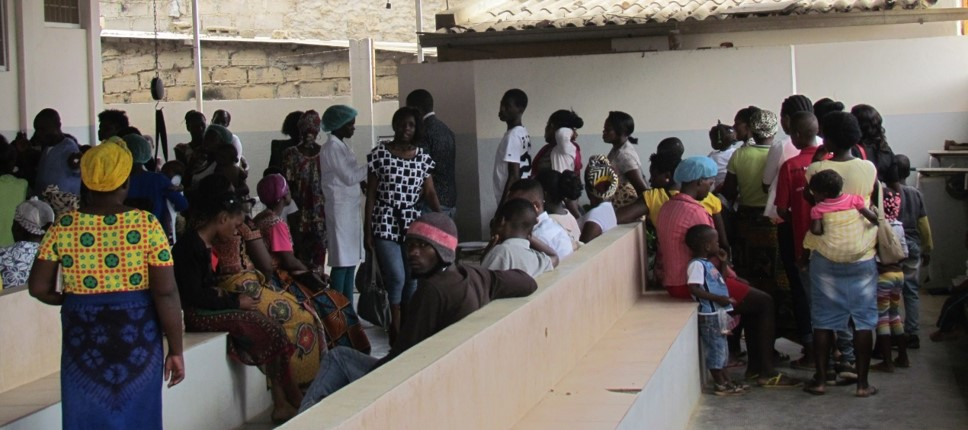
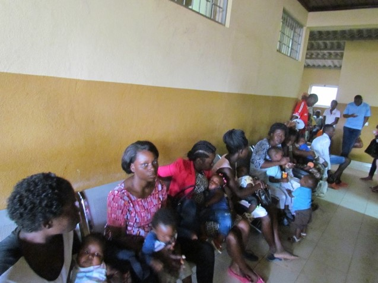
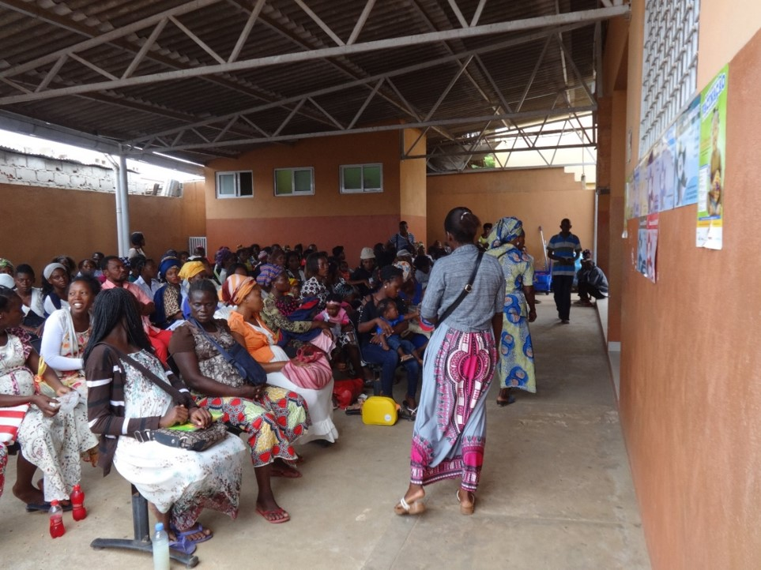
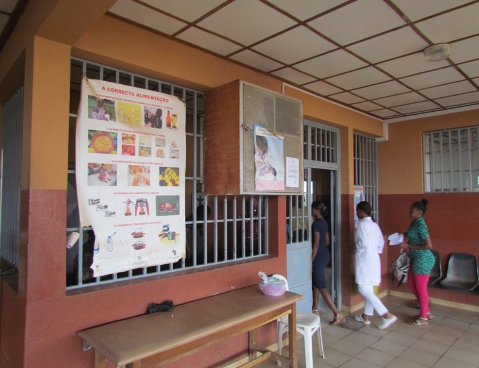
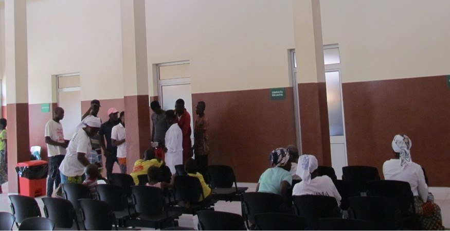

[Hospital Divina Providência](https://maps.app.goo.gl/MUC1PeFY3kJiVYa28)

[Ver no Google Maps](https://maps.app.goo.gl/MUC1PeFY3kJiVYa28)

Avenida Pedro De Castra Van Dunem, Bairro Golf, Município Kilamba Kiaxi , Luanda, Angola.

Tel-Fax (+244) 991 144 631 / 916 025 301;

Site: [http://www.hospitaldivinaprovidencia.net](http://www.hospitaldivinaprovidencia.net);

E-mail: geral@hospitaldivinaprovidencia.net;

* * *

**Centro de Saúde São João Calábria**

Município del Kilamba Kiaxi, Sub-zona 10

* * *

**Centro de Saúde Nossa Senhora da Paz**

Município del Kilamba Kiaxi, Golf 2

* * *

**Centro de Saúde Santa Catarina**

Município del Kilamba Kiaxi, Palanca

* * *

**Centro de Saúde Santa Teresinha**

Município del Kilamba Kiaxi, Sub-zona 7

* * *

**Centro Médico São Marcos**

Município del Kilamba Kiaxi, Kapolo 2, zona Sapú.
