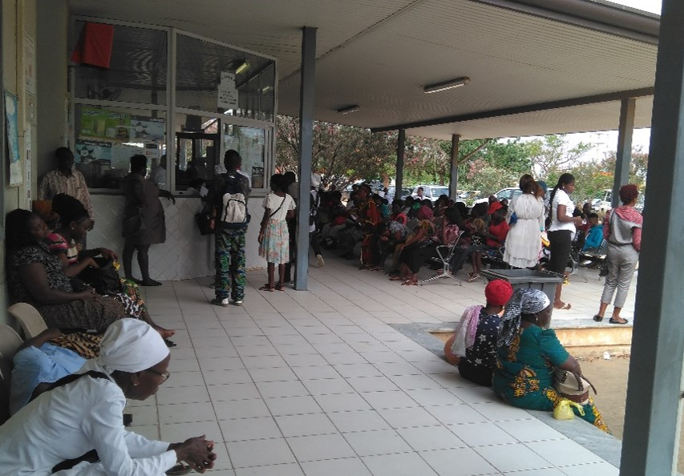

<section class="local">

## [Hospital Divina Providência](https://www.google.com/maps/search/?api=1&query=-8.876395147435874%2C13.268005165664476)

[Ver no Google Maps](https://www.google.com/maps/search/?api=1&query=-8.876395147435874%2C13.268005165664476)

Avenida Pedro De Castra Van Dunem, Bairro Golf, Município Kilamba Kiaxi , Luanda, Angola.

Tel-Fax (+244) 991 144 631 / 916 025 301;

Site: [http://www.hospitaldivinaprovidencia.net](http://www.hospitaldivinaprovidencia.net);

E-mail: geral@hospitaldivinaprovidencia.net;

</section>

<section class="local">

## Centro de Saúde São João Calábria

Município de Kilamba Kiaxi, Sub-zona 10

[Ver no Google Maps](https://www.google.com/maps/search/?api=1&query=-8.860727032755117%2C13.244776270329032)

</section>

<section class="local">

## Centro de Saúde Nossa Senhora da Paz

Município de Kilamba Kiaxi, Golf 2

[Ver no Google Maps](https://www.google.com/maps/search/?api=1&query=-8.880599132795126%2C13.253043275127462)

</section>

<section class="local">

## Centro de Saúde Santa Catarina

Município de Kilamba Kiaxi, Palanca

[Ver no Google Maps](https://www.google.com/maps/search/?api=1&query=-8.875285596648588%2C13.277176285266185)

</section>

<section class="local">

## Centro de Saúde Santa Teresinha

Município de Kilamba Kiaxi, Sub-zona 7

[Ver no Google Maps](https://www.google.com/maps/search/?api=1&query=-8.87164302174692%2C13.26155238429675)

</section>

<section class="local">

## Centro Médico São Marcos

Município de Kilamba Kiaxi, Kapolo 2, zona Sapú.

[Ver no Google Maps](https://www.google.com/maps/search/?api=1&query=-8.879338459923051%2C13.29719267520468)

</section>

