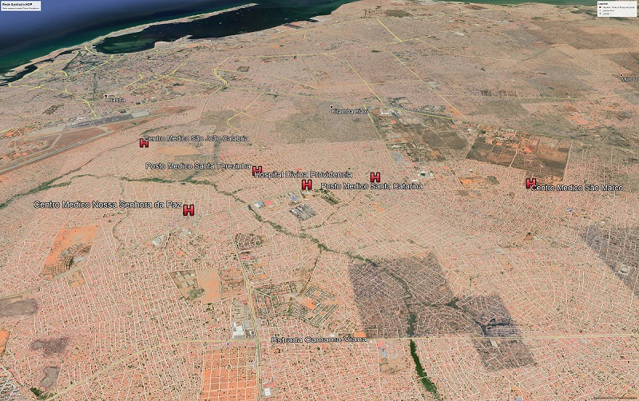
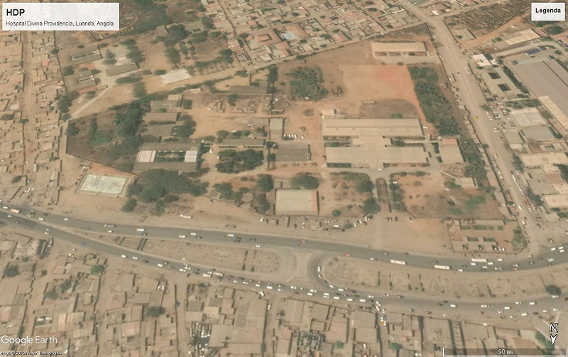
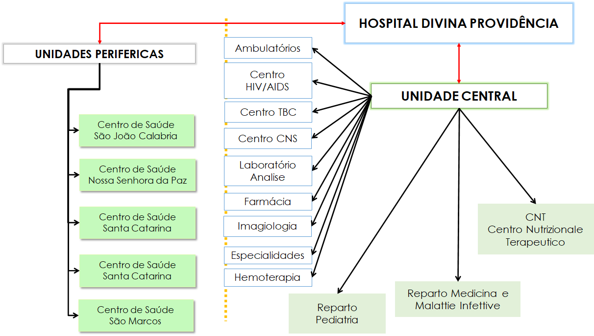

Aa rede sanitária do **HDP** é constituída por uma Unidade Central e 5 (cinco) centros periféricos de saúde.

**Unidade Central**:

**Unidades Perifericas de de Saúde:**

São João Calabria (SJC), Laboratório, Farmácia

Nossa Senhora da Paz (NSP), Laboratório, Farmácia

Santa Caterina (SC)

Santa Teresinha (ST), fechado por falta de recursos e pessoal.

São Marcos (SM), Laboratório, Farmácia, Oftalmologia

