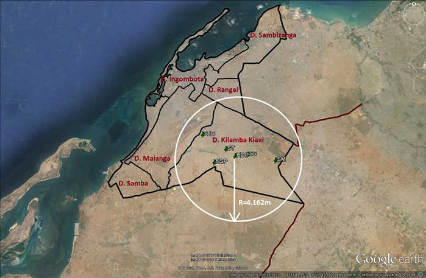

Aa rede sanitária do **HDP** é constituída por 5 centros periféricos de saúde e una unidade central.

**Centros Periféricos de Saúde:**

1) São João Calabria (SJC), Laboratório, Farmácia

2) Nossa Senhora da Paz (NSP), Laboratório, Farmácia

3) Santa Caterina (SC)

4) Santa Teresinha (ST), fechado por falta de recursos e pessoal.

5) São Marcos (SM), Laboratório, Farmácia, Oftalmologia

**Unidade Central**:

Ø146 camas (60 Pediatria, 61 Medicina e TB/HIV, 25 CNT);

Ø1 Centro de Doenças Infeciosas HIV/AIDS e Tuberculose;

Ø1 Centro Nutricional Terapêutico e de Seguimento;

Ø11 Consultas de especialidade;

Ø1 Laboratório Analises;

Ø1 Farmácia;

Ø1 Imagiologia (RX, Ecografia, Eco-cardiografia);

